# PCFPG — Parameter-Conditioned Floor Plan Generator

**PCFPG** is a graph-conditioned floor-plan generation system. Give it a building boundary, a set of rooms, room-to-room connections, and optional room-size preferences. It generates multiple candidate layouts, ranks them, and produces a labelled 2D plan together with an interactive 3D view.

The project combines a **Streamlit-based floor-plan studio**, two neural-network stages, and a geometric reconstruction pipeline.

> **Project repository:** [github.com/nerfelitewar/PCFPG](https://github.com/nerfelitewar/PCFPG)  
> **Dataset:** [ResPlan — 17,000 residential floor plans](https://github.com/m-agour/ResPlan)

---

## Contents

- [What PCFPG does](#what-pcfpg-does)
- [How the model works](#how-the-model-works)
- [Repository structure](#repository-structure)
- [Getting started](#getting-started)
- [Download and prepare the dataset](#download-and-prepare-the-dataset)
- [Run the application](#run-the-application)
- [Generate from JSON using the CLI](#generate-from-json-using-the-cli)
- [Input JSON format](#input-json-format)
- [Application walkthrough](#application-walkthrough)
- [Train the models](#train-the-models)
- [Evaluation](#evaluation)
- [Generated files and exports](#generated-files-and-exports)
- [Configuration and compatibility](#configuration-and-compatibility)
- [Troubleshooting](#troubleshooting)
- [Dataset attribution and references](#dataset-attribution-and-references)

---

## What PCFPG does

PCFPG converts a building footprint and a room-connectivity graph into a complete floor-plan proposal.

| Capability | What it does |
|---|---|
| **Boundary conditioning** | Uses the building outline and entrance location as spatial constraints. |
| **Room-graph conditioning** | Uses room types and room-to-room relationships to guide the layout. |
| **Room-size conditioning** | Optional relative room-size preferences influence the generated proportions. |
| **Multiple candidates** | Generates several layout hypotheses and ranks them to select a strong candidate. |
| **Geometric reconstruction** | Converts predicted room regions into clean, axis-aligned room polygons. |
| **Architectural elements** | Builds walls, places doors from room connections, adds windows, and places the entrance. |
| **2D and 3D output** | Displays a labelled 2D plan and an interactive browser-based 3D model. |
| **Diagnostics and export** | Shows layout-quality metrics and lets you download the specification, plan, 3D viewer, and metrics. |

The application is designed so that you can work visually in the browser. You do not need to manually write the JSON input, although the application can show the JSON specification it creates.

---

## How the model works

PCFPG separates learned layout prediction from deterministic geometric reconstruction.

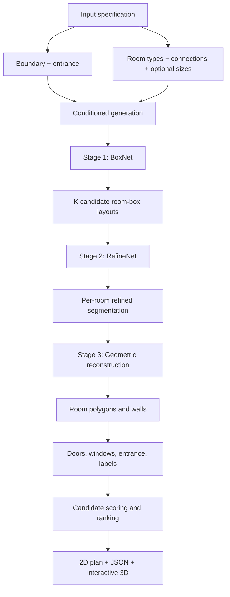

### Stage 1 — BoxNet

- A graph Transformer processes room types and room connections.
- Adaptive Layer Normalization (AdaLN) incorporates optional room-size conditioning.
- The network proposes multiple room-box arrangements from different noise hypotheses.
- Winner-takes-all supervision encourages the model to produce diverse plausible layouts.

### Stage 2 — RefineNet

- A U-Net refines the room boxes into a per-room segmentation map.
- Edge-weighted cross-entropy encourages accurate room boundaries.
- An anisotropic total-variation term encourages cleaner, straighter borders.
- Optional test-time augmentation averages predictions from flipped and rotated inputs.

### Stage 3 — Geometric reconstruction

This stage is deterministic post-processing; it is not a neural network.

- Restores rooms that may have been dropped during prediction.
- Converts room regions into Manhattan-style polygons with right-angle corners.
- Constructs walls and places doors using the requested room connections.
- Repairs connectivity when needed, then adds windows, the entrance, and labels.

### Candidate selection

`generate.py` evaluates the generated candidates and selects the highest-scoring layout. The scorer can use hand-designed weights or calibrated weights produced by `calibrate_score.py`.

---

## Repository structure

The main files and folders are:

```text
PCFPG/
├── app.py                    # Streamlit floor-plan studio
├── boundary_editor/          # Interactive building-boundary editor
├── room_graph/               # Interactive room-connection graph editor
├── static/                   # Static browser assets and visualizer
├── assets/                   # README screenshots
├── checkpoints/              # BoxNet and RefineNet model weights
├── data/                     # Preprocessed training and evaluation caches
├── docs/                     # Project documentation
├── logs/                     # Training, calibration, and evaluation logs
├── outputs/                  # Generated output files
├── paper/                    # Research-paper material
├── samples/                  # Example input JSON files
├── common.py                 # Shared configuration and utilities
├── graphdata.py              # Dataset-to-graph/sample conversion
├── prepare_data.py           # Dataset preprocessing
├── models.py                 # BoxNet and RefineNet definitions
├── train_box.py              # Stage 1 training
├── train_refine.py           # Stage 2 training and fine-tuning
├── layout.py                 # Geometry, walls, doors, windows, and exports
├── generate.py               # Inference, candidate generation, and scoring
├── calibrate_score.py        # Candidate-score calibration
├── evaluate.py               # Test-set evaluation
├── metrics.py                # Layout metrics
├── requirements.txt          # Core Python dependencies
├── viewer_template.html      # Interactive 3D viewer template
└── colab_kaggle_train.ipynb   # Hosted training notebook
```

---

## Getting started

These instructions use **Windows 10/11 and PowerShell**. A CUDA-capable NVIDIA GPU is recommended for training and faster inference. CPU execution may also be possible, but can be significantly slower.

### Prerequisites

Install:

- Git
- Python 3.10 or newer
- A compatible NVIDIA driver if you plan to use CUDA

### 1. Clone the project

```powershell
git clone https://github.com/nerfelitewar/PCFPG.git floorplan_gen
cd floorplan_gen
```

### 2. Create a virtual environment

```powershell
python -m venv .venv
.\.venv\Scripts\Activate.ps1
python -m pip install --upgrade pip
```

If PowerShell blocks environment activation, run this in the same terminal and activate again:

```powershell
Set-ExecutionPolicy -Scope Process -ExecutionPolicy Bypass
.\.venv\Scripts\Activate.ps1
```

### 3. Install dependencies

For an NVIDIA RTX 50-series GPU, the development setup used the CUDA 12.8 PyTorch wheels:

```powershell
pip install torch torchvision --index-url https://download.pytorch.org/whl/cu128
pip install -r requirements.txt
pip install streamlit plotly pandas
```

The last command installs the additional packages used by the Streamlit interface. For a different GPU, CUDA version, or CPU-only setup, select the matching PyTorch build from the [official PyTorch installation selector](https://pytorch.org/get-started/locally/).

Check CUDA availability:

```powershell
python -c "import torch; print('CUDA available:', torch.cuda.is_available()); print('GPU:', torch.cuda.get_device_name(0) if torch.cuda.is_available() else 'CPU mode')"
```

---

## Download and prepare the dataset

PCFPG uses **ResPlan**, a dataset containing 17,000 residential floor plans.

### Official dataset links

- **Dataset archive:** [Direct download: `ResPlan.zip`](https://github.com/m-agour/ResPlan/raw/refs/heads/main/ResPlan.zip) · [view the official file page](https://github.com/m-agour/ResPlan/blob/main/ResPlan.zip) (approximately 95.5 MB).
- **Canonical train/validation/test splits:** [`split.json`](https://github.com/m-agour/ResPlan/blob/main/split.json).
- **Official dataset repository:** [m-agour/ResPlan](https://github.com/m-agour/ResPlan).
- **Research paper:** [ResPlan paper — arXiv:2508.14006](https://arxiv.org/abs/2508.14006).

Use the upstream repository above rather than an unverified mirror. The `ResPlan.zip` archive contains the dataset pickle; `split.json` is a separate file and must also be available to the preprocessing script.

### Expected folder layout

The project looks for the dataset in a sibling folder named `ResPlan` by default (`ROOT.parent / "ResPlan"`). Your workspace should look like this:

```text
workspace/
├── floorplan_gen/          # this repository
│   ├── app.py
│   ├── prepare_data.py
│   └── ...
└── ResPlan/
    ├── ResPlan.pkl
    └── split.json
```

### Download using PowerShell

Run these commands from the **project root** (named `floorplan_gen` in the example above). The first command moves to the parent workspace directory so that `floorplan_gen` and `ResPlan` become sibling folders.

```powershell
cd ..
git clone https://github.com/m-agour/ResPlan.git ResPlan-source
New-Item -ItemType Directory -Force ResPlan | Out-Null
Expand-Archive -Path .\ResPlan-source\ResPlan.zip -DestinationPath .\ResPlan -Force
Copy-Item .\ResPlan-source\split.json .\ResPlan\split.json -Force
```

Verify the required files:

```powershell
Test-Path .\ResPlan\ResPlan.pkl
Test-Path .\ResPlan\split.json
```

Both commands should return `True`. If extraction creates an extra nested folder, move `ResPlan.pkl` into the top-level `ResPlan` folder.

Return to the project directory before running the next commands:

```powershell
cd .\floorplan_gen
```

If you keep the dataset somewhere else, pass its path explicitly when preprocessing:

```powershell
python prepare_data.py --data-dir "D:\path\to\ResPlan"
```

---

## Run the application

Make sure the dataset is in place and that the compatible model checkpoints are available.

The inference application expects these two model files:

```text
checkpoints/
├── box_best.pt
└── refine_best.pt
```

If the files are stored elsewhere, use the **Stage 1 weights** and **Stage 2 weights** fields in the application sidebar to provide their paths.

Start the Streamlit application from the project root:

```powershell
streamlit run app.py
```

Then open the local address printed in the terminal (normally `http://localhost:8501`).

### Typical application workflow

1. **Boundary:** draw or select the building outline and position the entrance.
2. **Rooms & connections:** add rooms, choose their relative sizes, and define door or adjacency relationships.
3. **Review & generate:** check the validation list and model-weight status, then choose how many candidates to generate.
4. **Inspect results:** review the selected plan, switch to the 3D view, compare candidates, and inspect metrics.
5. **Export:** download the input specification, 2D plan, 3D HTML viewer, and metrics CSV.

The application loads trained checkpoints for inference. It does **not** train the networks each time you press Generate.

---

## Generate from JSON using the CLI

You can also call the generation pipeline without using the Streamlit interface.

Generate three candidates for a sample input:

```powershell
python generate.py --input samples/rect_2bhk.json --n-samples 3
```

Generate plans for all JSON samples in the sample directory:

```powershell
python generate.py --samples-dir samples
```

Check the command options supported by your local version:

```powershell
python generate.py --help
```

---

## Input JSON format

A generation request describes the building boundary, rooms, room connections, and optionally the front-door position, entrance room, and relative room sizes.

### Example

```json
{
  "name": "my_flat",
  "boundary": [[0, 0], [12, 0], [12, 9], [0, 9]],
  "front_door": [6, 0],
  "rooms": [
    {"id": "living", "type": "living"},
    {"id": "kitchen", "type": "kitchen"},
    {"id": "bed1", "type": "bedroom"},
    {"id": "bath1", "type": "bathroom"},
    {"id": "balcony", "type": "balcony"}
  ],
  "connections": [
    ["living", "kitchen"],
    ["living", "bed1"],
    ["bed1", "bath1"],
    ["living", "balcony"]
  ],
  "entrance": "living"
}
```

---

## Application walkthrough

This section follows the same order as a normal run of the application: define the boundary, create the room graph, validate the input, generate layouts, and inspect the results.

> The screenshots below are stored in the repository's `assets/` folder. Keep the filenames unchanged, or update the corresponding image paths in this README.

### 1. Define the building boundary

Start by drawing the outer footprint of the building. You can choose a basic shape, edit its corner coordinates, and place the front entrance on an exterior wall.

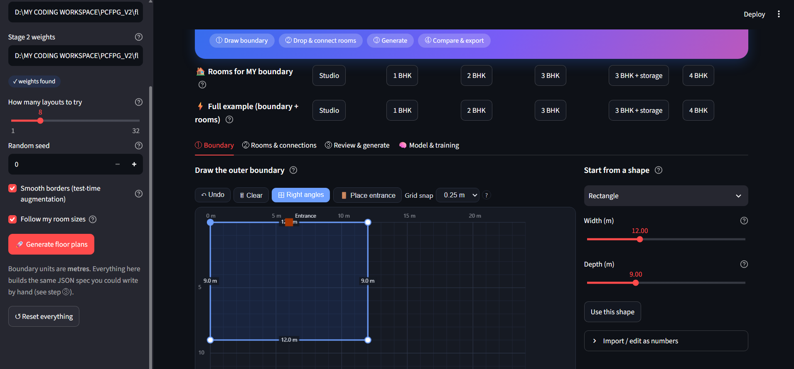

### 2. Add rooms and connections

Create the rooms that should appear in the floor plan and connect them to describe how they relate to one another. The graph represents **which rooms should connect**, not their final physical positions.

- A solid connection requests a door between two rooms.
- A dashed adjacency connection requests a shared wall without a door.
- Room-size controls provide relative size preferences when size conditioning is enabled.

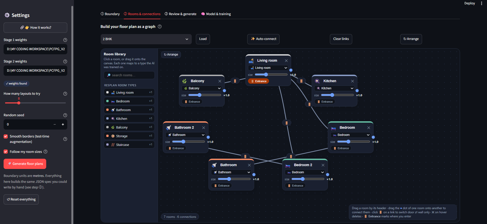

### 3. Review the input and generate

Before generation, PCFPG checks the boundary, room graph, and model-weight paths. Resolve any failed checklist items, then start generation. The JSON expander shows the specification that will be passed to the generator.

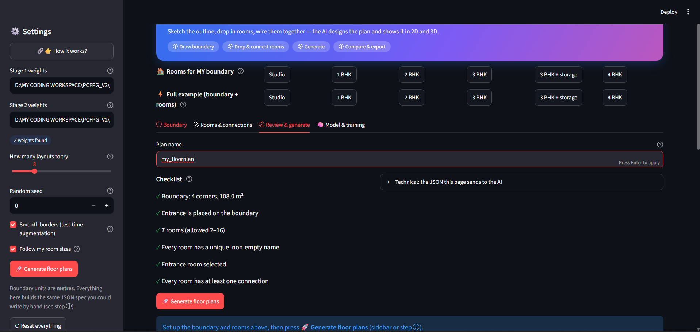

### 4. Inspect the generated result

After generation, the application reports the selected layout and the number of candidate layouts that were evaluated. The result view provides the generated plan and its quality summary.

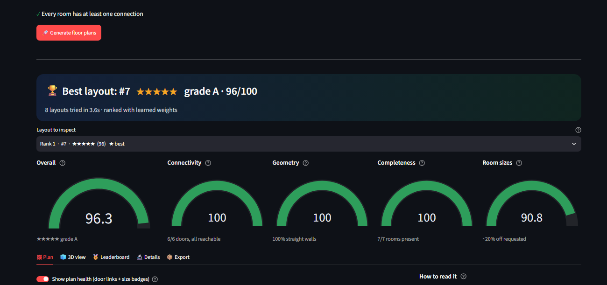

The following screenshot continues the generated-results walkthrough.

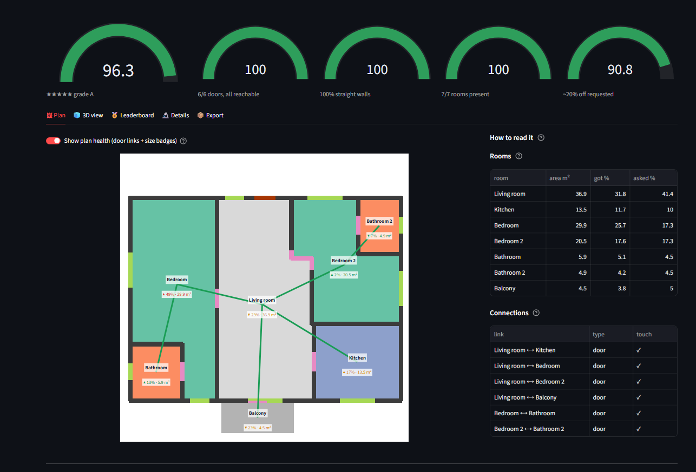

### 5. Explore the interactive 3D view

Open the **3D view** tab to inspect the generated floor plan as a 3D model.

- **Drag:** rotate the model.
- **Mouse wheel:** zoom in or out.
- **Shift + drag:** pan the view.
- **Labels control:** show or hide room names.

The 3D viewer may need an internet connection the first time it loads its 3D library.

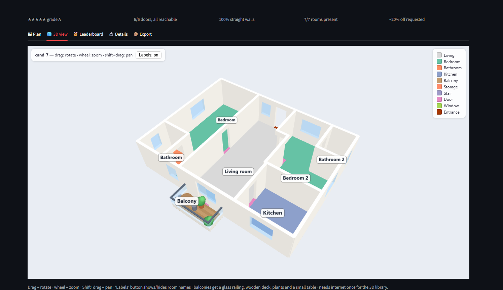

### 6. Compare the best-of-K candidates

PCFPG does not have to settle for the first layout it generates. It can create `K` candidates, score them, and display them in ranked order. Use the leaderboard to compare alternatives and open a candidate for inspection.

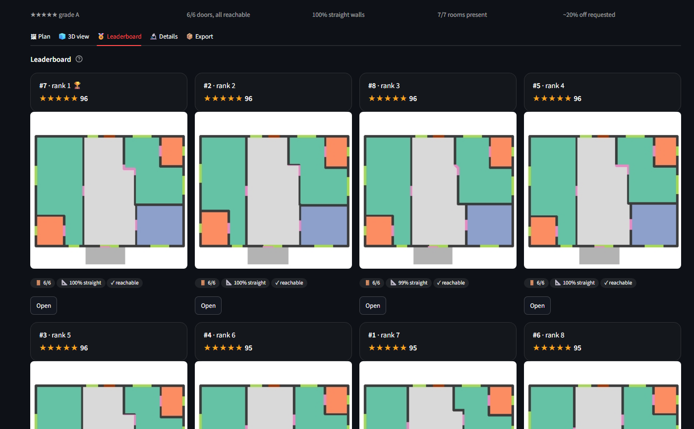

### 7. Inspect layout details

The details view exposes the information behind a selected candidate, including room placement, room areas, requested connections, and generation-stage diagnostics.

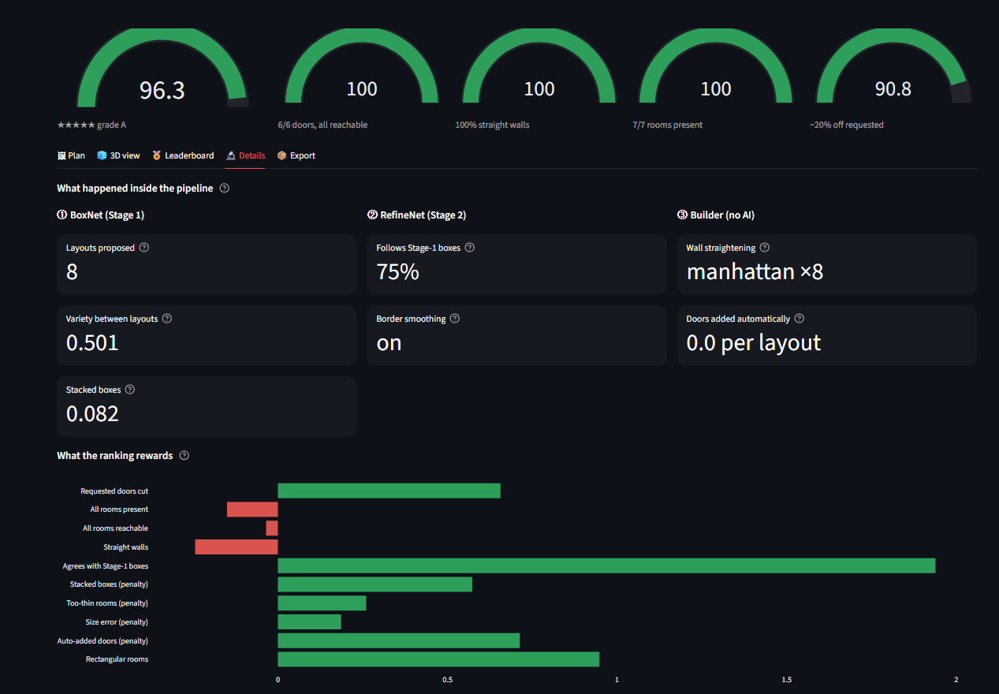

### 8. Review the metrics

The metrics view helps assess the generated result beyond its visual appearance. Depending on the selected view, the application reports signals such as connectivity, room completeness, wall straightness, room-size deviation, candidate diversity, and model evaluation scores.

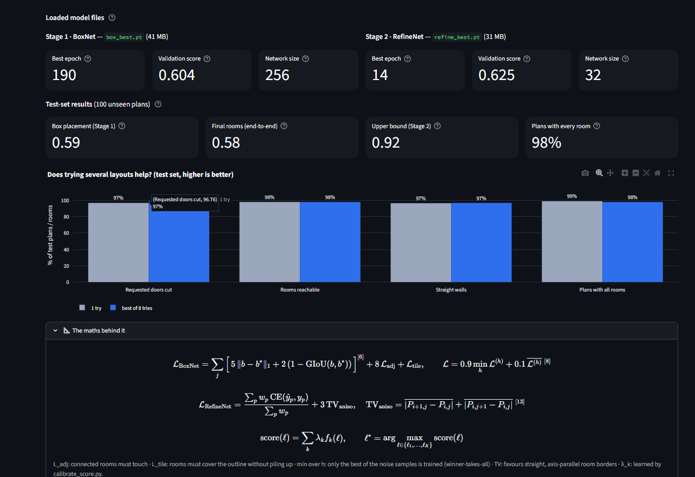

### 9. Understand the model and generation flow

The **Model & training** view explains how the dataset is prepared, how the two networks are trained, and what happens to a user-provided layout during inference.

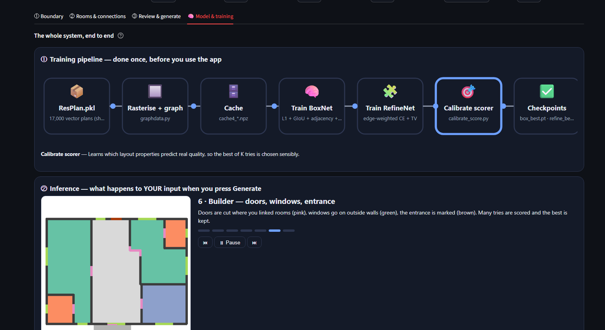

---

## Input fields

| Field | Required | Description |
|---|---|---|
| `name` | No | Name used when creating output files. |
| `boundary` | Yes | Polygon coordinates describing the building footprint. Use coordinates in metres when working through the Streamlit interface. |
| `rooms` | Yes | Room IDs and semantic room types. |
| `connections` | No | Room-to-room relationships. If omitted, the generator creates a typical default graph. |
| `front_door` | No | Point on or near the exterior boundary; it is snapped to the nearest wall. |
| `entrance` | No | Room connected to the building entrance; defaults to the living room when available. |
| `use_area` | No | Set to `false` to disable relative room-size conditioning. |

### Supported room types

The current model supports these seven room types:

`living`, `bedroom`, `bathroom`, `kitchen`, `balcony`, `storage`, and `stair`.

The current model input limit is **16 rooms per plan**.

### Relative room sizes

The optional `area` value is a **relative weight**, not a strict room-area constraint. A larger value encourages the generator to allocate more space to that room. Rooms without an `area` value use typical room-size defaults.

```json
{"id": "bed1", "type": "bedroom", "area": 16}
```

To disable size conditioning:

```json
{"use_area": false}
```

### Room connections

A two-item connection requests a door between the two rooms:

```json
["living", "kitchen"]
```

A three-item connection with `adjacent` requests a shared wall without a door:

```json
["living", "kitchen", "adjacent"]
```

### Room-count shortcut

You can use room counts instead of listing every room object. The generator expands the counts into individual room IDs:

```json
{
  "rooms": {
    "living": 1,
    "bedroom": 3,
    "bathroom": 2,
    "kitchen": 1
  }
}
```

A list of room type names can also be used. If `connections` is omitted, PCFPG creates a typical graph with the living room acting as a hub and bathrooms generally attached to bedrooms.

---

## Train the models

Training is only required when compatible checkpoints are unavailable or when you want to retrain or fine-tune the networks.

### 1. Prepare the dataset

Run preprocessing once after placing `ResPlan.pkl` and `split.json` in the expected dataset directory:

```powershell
python prepare_data.py
```

This creates the processed cache files used by training. To limit the number of plans for a quick pipeline check:

```powershell
python prepare_data.py --limit 500
```

### 2. Train Stage 1 — BoxNet

```powershell
python train_box.py --epochs 200 --d 256 --heads 8 --layers 6
```

The v3.2 architecture includes AdaLN conditioning. An older BoxNet checkpoint from before this architecture is not compatible; retrain Stage 1 when upgrading to v3.2.

### 3. Fine-tune Stage 2 — RefineNet

With a compatible BoxNet checkpoint available:

```powershell
python train_refine.py --epochs 15 --lr 5e-4 --init checkpoints\refine_best.pt --boxnet checkpoints\box_best.pt
```

To train RefineNet from scratch instead:

```powershell
python train_refine.py --epochs 40
```

### 4. Calibrate candidate scoring

```powershell
python calibrate_score.py --n 300
```

Calibration compares candidate-selection strategies and learns weights for ranking generated layouts.

### 5. Evaluate the model

```powershell
python evaluate.py
```

Evaluation results are written to `logs/eval_test.json`.

### 6. Generate layouts

```powershell
python generate.py --samples-dir samples
```

### Resume training

Add `--resume` to a supported training command. For example:

```powershell
python train_box.py --epochs 200 --d 256 --heads 8 --layers 6 --resume
```

Check each script's `--help` output for the arguments supported by your local version.

### Quick smoke test

A short smoke test can help verify that preprocessing and both training scripts run before starting a full experiment:

```powershell
python prepare_data.py --limit 500
python train_box.py --epochs 3
python train_refine.py --epochs 1 --base 16
```

This is a pipeline check, not a meaningful training run or model evaluation.

### Google Colab or Kaggle

The [`colab_kaggle_train.ipynb`](colab_kaggle_train.ipynb) notebook can be used for hosted training. After training, copy compatible `box_best.pt` and `refine_best.pt` files into the local `checkpoints/` directory.

---

## Evaluation

Run the evaluator with:

```powershell
python evaluate.py
```

The results are written to `logs/eval_test.json`. The evaluator reports metrics including:

| Metric | Meaning |
|---|---|
| `box_iou_true` / `box_iou_true_sizes` | Room-box overlap when the requested room sizes are used. |
| `box_iou_default` | Room-box overlap using default room-size settings. |
| `box_iou_no_sizes` | Room-box overlap without size conditioning. |
| `box_iou_oracle_best_of_8` | Best candidate IoU under an oracle selection upper bound, when available. |
| `sample_diversity_L1` | Diversity between noise-generated samples. |
| `room_iou_gt_box` | Refined room overlap when ground-truth boxes are supplied. |
| `room_iou_e2e` | End-to-end room overlap after both networks. |
| `doors_placed` | Fraction or count of requested doors successfully placed, as reported by the evaluator. |
| `all_rooms_connected` | Whether all rooms are reachable in the generated layout. |
| `plans_with_all_rooms` | Whether all requested rooms are present. |
| `straightness` | How closely room boundaries follow straight, axis-aligned edges. |
| `rectangularity` | How closely room polygons resemble rectangles. |

The Streamlit application can also display test-set scores, training curves, candidate-selection comparisons, and per-candidate diagnostics when the corresponding log files are present.

Do not interpret a training or validation score as a test-set result. The real-plan reference values for straightness and rectangularity in the development notes are dataset statistics, not guaranteed PCFPG generation scores.

---

## Generated files and exports

### From the Streamlit application

The Export tab provides downloads for:

| Download | Description |
|---|---|
| **Spec (JSON)** | The input specification used for the generation run. |
| **Plan (PNG)** | The selected labelled 2D floor plan. |
| **3D viewer (HTML)** | A standalone interactive 3D floor-plan viewer. |
| **Metrics (CSV)** | Candidate-level metrics in a spreadsheet-friendly format. |

The application also saves the run's files in the output directory shown in the interface.

### From the CLI

The command-line pipeline writes generated results under `outputs/`:

| Output | Description |
|---|---|
| `<name>.png` | Labelled 2D floor plan. |
| `<name>.json` | Generated plan data. |
| `<name>_3d.html` | Interactive 3D floor-plan viewer. |

The 3D view supports drag-to-rotate, mouse-wheel zoom, and `Shift` + drag to pan.

A CLI status line may look like this:

```text
rooms 7/7  doors 6/6 (+1 auto)  windows 8  connected True  best of 8
```

This example indicates that all seven requested rooms were placed, all six requested doors were placed, one additional door was added to repair connectivity, eight windows were generated, and the selected plan was the best-scoring candidate among eight generated layouts.

---

## Configuration and compatibility

The following settings were used during development:

| Component | Setting | Purpose |
|---|---|---|
| Stage 1 | `--d 256 --heads 8 --layers 6 --epochs 200` | BoxNet capacity and training duration. |
| Stage 1 | `--adj 12` | Adjacency-related loss weighting in the training script. |
| Stage 2 | `--base 48 --epochs 60` | RefineNet capacity and training duration. |
| Generation | `--k 16` | Number of candidate hypotheses to generate. |

Compatibility notes:

- The current v3.2 pipeline uses AdaLN layers in BoxNet.
- A pre-v3.2 `box_best.pt` checkpoint is not compatible with the v3.2 BoxNet architecture. Retrain Stage 1 before using the current pipeline with such a checkpoint.
- The `refine_best.pt` checkpoint and `data/cache4_*.npz` cache format are retained from v3.1 according to the project development notes.
- Checkpoint files must match the model architecture expected by the code being run.

---

## Troubleshooting

### `torch.cuda.is_available()` returns `False`

Check that the NVIDIA driver is installed and working. Reinstall the PyTorch build that matches your CUDA setup using the [official PyTorch installation selector](https://pytorch.org/get-started/locally/), then rerun the CUDA verification command.

### Dataset file not found

Confirm that both `ResPlan.pkl` and `split.json` exist in the dataset directory. By default, the project expects a sibling `ResPlan/` folder next to the project directory. Otherwise, pass the dataset path using `--data-dir` when running `prepare_data.py`.

### Model checkpoint missing

Inference requires compatible BoxNet and RefineNet checkpoint files. Set their paths in the application sidebar or train the models using the instructions above. A `checkpoints/` directory by itself does not mean that the required weight files are present.

### Old BoxNet checkpoint fails to load

The current v3.2 BoxNet architecture includes AdaLN layers. Retrain Stage 1 and use the resulting compatible `checkpoints/box_best.pt` file.

### The 3D viewer does not load

Open the generated HTML viewer in a modern browser. The viewer may need an internet connection once to load its 3D library. Also confirm that generation completed and the HTML export exists.

### PowerShell blocks virtual-environment activation

Run the following in the current PowerShell session, then activate the environment again:

```powershell
Set-ExecutionPolicy -Scope Process -ExecutionPolicy Bypass
.\.venv\Scripts\Activate.ps1
```

---

## Dataset attribution and references

PCFPG uses **ResPlan: A Large-Scale Vector-Graph Dataset of 17,000 Residential Floor Plans**.

- **Dataset and source code:** [m-agour/ResPlan](https://github.com/m-agour/ResPlan).
- **Dataset archive:** [`ResPlan.zip`](https://github.com/m-agour/ResPlan/blob/main/ResPlan.zip).
- **Research paper:** [arXiv:2508.14006](https://arxiv.org/abs/2508.14006).
- **Dataset licence:** The upstream repository identifies the released data files as [Creative Commons Attribution 4.0 International (CC BY 4.0)](https://creativecommons.org/licenses/by/4.0/). The upstream repository separately licenses its code under MIT; consult its [LICENSE](https://github.com/m-agour/ResPlan/blob/main/LICENSE) for the exact scope.
- **Takedown policy:** See the upstream [`TAKEDOWN.md`](https://github.com/m-agour/ResPlan/blob/main/TAKEDOWN.md).

The dataset is maintained by its original authors. PCFPG is a separate project that uses the dataset. Attribute ResPlan to its authors and review the upstream licence before redistributing dataset files.

### Related work

- Hu, R. et al. **Graph2Plan: Learning Floorplan Generation from Layout Graphs.** ACM Transactions on Graphics, 2020.
- Ronneberger, O., Fischer, P., and Brox, T. **U-Net: Convolutional Networks for Biomedical Image Segmentation.** MICCAI, 2015.
- Vaswani, A. et al. **Attention Is All You Need.** NeurIPS, 2017.
- Peebles, W. and Xie, S. **Scalable Diffusion Models with Transformers.** ICCV, 2023.
- Rezatofighi, H. et al. **Generalized Intersection over Union.** CVPR, 2019.
- Nauata, N. et al. **House-GAN: Relational Generative Adversarial Networks for Graph-Constrained House Layout Generation.** ECCV, 2020.

---
